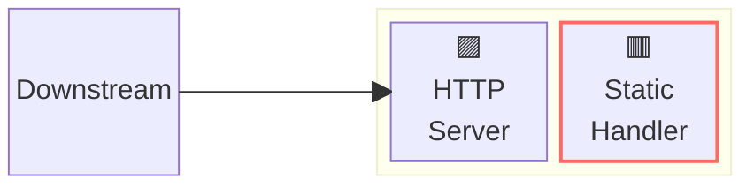
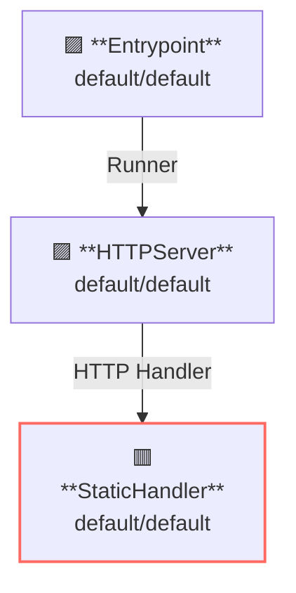

## Overview

This example runs a template server that returns response generated from templates.



**Legend**:

- 🟥 `#ff6961` Handler resources.
- 🟩 `#77dd77` Middleware resources (Server-side middleware).
- 🟦 `#89CFF0` Tripperware resources (Client-side middleware).
- 🟪 `#9370DB` Other resources.

In this example, following directory structure and files are supposed.
If you need a pre-built binary, download from [GitHub Releases](https://github.com/aileron-gateway/aileron-gateway/releases).

```txt
template/           ----- Working directory.
├── aileron         ----- AILERON Gateway binary (aileron.exe on windows).
├── config.yaml     ----- AILERON Gateway config file.
└── root/           ----- Root directory that contains served contents.
    ├── hello.html  ----- Example content.
    ├── hello.json  ----- Example content.
    └── hello.xml   ----- Example content.
```

## Config

Configuration yaml to run a server with template handler would becomes as follows.

```yaml
# config.yaml

apiVersion: core/v1
kind: Entrypoint
spec:
  runners:
    - apiVersion: core/v1
      kind: HTTPServer

---
apiVersion: core/v1
kind: HTTPServer
spec:
  addr: ":8080"
  virtualHosts:
    - handlers:
        - handler:
            apiVersion: core/v1
            kind: StaticFileHandler

---
apiVersion: core/v1
kind: StaticFileHandler
spec:
  rootDir: "./root/"
  enableListing: true
  header: # Additional response headers.
    Cache-Control: no-cache
```

The config tells:

- Start a `HTTPServer` with port 8080.
- Static handler is registered to the server (all paths match).
  - Use `./root/` directory as root path.

This graph shows the resource dependencies of the configuration.



## Run

Run the AILERON Gateway with command:

```bash
./aileron -f ./config.yaml
```

## Check

After running a server, send HTTP requests to it.
Content type of response bodies are sniffed by Go's [DetectContentType](https://pkg.go.dev/net/http#DetectContentType).

```json
$ curl http://localhost:8080/hello.json

{ "hello": "AILERON Gateway" }
```

```xml
$ curl http://localhost:8080/hello.xml

<hello>AILERON Gateway</hello>
```
